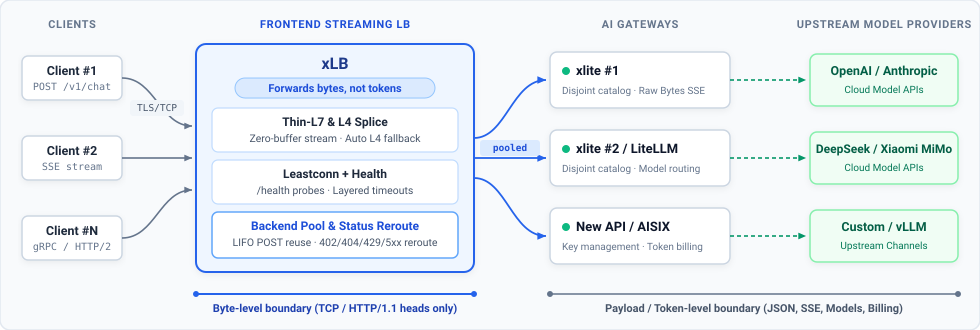
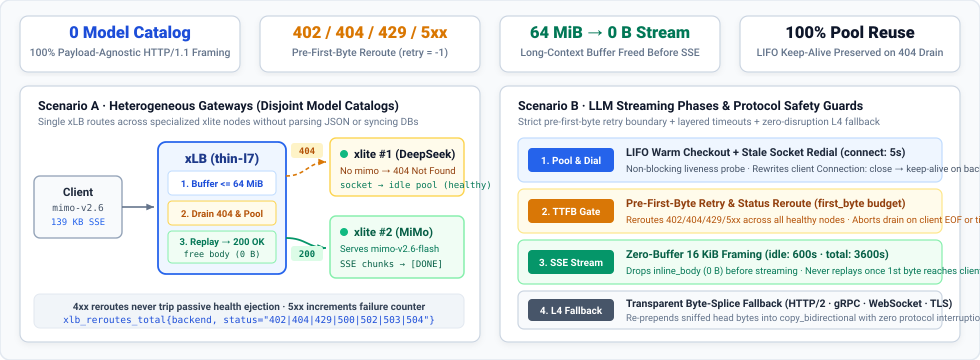

# xLB

**xLB** is a streaming-first load balancer for AI gateways ([xlite](https://github.com/EeroEternal/xlite), [LiteLLM](https://github.com/BerriAI/litellm), [New API](https://github.com/Calcium-Ion/new-api), [AISIX](https://github.com/aisix-team/aisix)) and inference clusters. It occupies the HAProxy role in the AI stack: **it forwards bytes, not tokens**, keeping added TTFT near zero while pooling backend connections across long-lived streaming `POST`s.

<p align="center">
  
</p>

## Why xLB (and why not just HAProxy?)

xLB is directly inspired by **HAProxy's core philosophy**: a load balancer should be a rock-solid byte mover with strict separation of concerns, leaving application semantics to the backends.

However, traditional load balancers and Ingress controllers were designed around short, idempotent web traffic, whereas AI inference traffic is almost entirely **long-lived, non-idempotent streaming `POST`s** (`POST /v1/chat/completions`). We built xLB in Rust to make AI streaming a first-class default rather than a fragile tuning exercise:

- **Aggressive `POST` connection pooling without payload inspection** — Traditional proxies (such as HAProxy's default `http-reuse safe`) avoid pooling backend connections across clients for non-idempotent `POST`s, while pure L4 proxies pin a client connection to one backend for its entire lifetime. xLB's `thin-l7` mode parses only HTTP/1.1 framing boundaries (`Content-Length` / chunked end) so every completed `POST` stream immediately returns its backend socket to a shared LIFO pool.
- **Timeouts and retries shaped for LLM inference** — LLM workloads have distinct phases: *dial (`connect`) → prefill wait (`first_byte`) → reasoning pauses (`idle`) → multi-minute generation (`total`)*. xLB enforces this layered timeout hierarchy natively and guarantees connection retries and HTTP status reroutes (`402`/`404`/`429`/`5xx`) happen **only before the first response byte** flows to the client.
- **Built-in TTFT attribution & zero-buffering** — General L7 proxies (Nginx, Envoy) often buffer bodies unless explicitly disabled per route. xLB streams response bodies in fixed 16 KiB chunks with zero aggregation and natively tracks `xlb_ttft_delta_ms` (the exact first-byte latency added by the proxy itself).
- **Decoupled from gateway lifecycles & model catalogs** — Keeps TLS termination, connection pooling, `/health` hysteresis, and pre-first-byte HTTP status rerouting out of the gateway process so LiteLLM, `xlite`, New API, or AISIX instances can scale, restart, or serve disjoint model subsets without dropping active streams or sharing a model catalog.

<p align="center">
  
</p>

## Forwarding Modes

- **`thin-l7` (default)** — Parses only HTTP/1.1 request and response heads (`httparse`), then streams response bodies verbatim. Because xLB knows exactly where a response ends (`Content-Length` or chunked trailer), it returns backend connections to the idle pool immediately after each stream and transparently reroutes retryable pre-first-byte HTTP status codes (`retry.retry_statuses`, default `[402, 404, 429, 500, 502, 503, 504]`) across healthy backends (`retry.max_retries = -1` by default). If a connection starts with non-HTTP/1.1 bytes (HTTP/2, WebSocket/`Upgrade`, `CONNECT`, or binary), xLB transparently replays the buffered bytes and falls back to `l4`.
- **`l4` (raw TCP splice)** — Pure bidirectional splice (`copy_bidirectional`) with zero protocol parsing and minimal CPU overhead. Best for raw gRPC/HTTP/2 passthrough when request-level connection pooling is not required.

Client-side HTTPS can be terminated directly on xLB in either mode via `[server.tls]` (rustls, PEM cert/key).

## Quick Start

**1. Install `xlb`**

```bash
# Option A: Download prebuilt binary (Linux x86_64; or use aarch64-unknown-linux-musl / aarch64-apple-darwin)
curl -fsSL https://github.com/EeroEternal/xlb/releases/latest/download/xlb-x86_64-unknown-linux-musl.tar.gz | tar -xz

# Option B: Run with Docker (GHCR or Docker Hub: eeroeternal/xlb:latest)
docker run --rm -p 8006:8006 -p 9106:9106 -v "$PWD/config.toml:/etc/xlb/config.toml:ro" ghcr.io/eeroeternal/xlb:latest
```

**2. Configure & run** (`./xlb --config config.toml`)

Minimal `config.toml` (see [`config.toml`](config.toml) for all timeout, pool, retry, TLS, and health check options):

```toml
[server]
bind = "0.0.0.0:8006"
mode = "thin-l7"          # thin-l7 (default) | l4

[backends]
algorithm = "leastconn"   # leastconn | roundrobin
servers = [
  { addr = "127.0.0.1:8001", weight = 1 },
  { addr = "127.0.0.1:8002", weight = 1 },
]

[retry]
max_retries = -1          # -1 (default) = try all remaining healthy backends; 0 = disabled
retry_statuses = [402, 404, 429, 500, 502, 503, 504]
```

## Documentation

- [Observability, Metrics & Verification](docs/observability.md) — Prometheus metrics (`:9106/metrics`), structured logging, and `curl` verification for TTFT & connection reuse
- [Full Configuration Reference](config.toml) — annotated `config.toml` with defaults
- [Architecture & Invariants](docs/architecture.md) — module layout, timeout hierarchy, and pooling rules
- [Design Rationale](docs/design.md) — tradeoffs behind `thin-l7` vs `l4`
- [Changelog](docs/changelog.md) — release history

## License

Released under the [MIT License](LICENSE).
